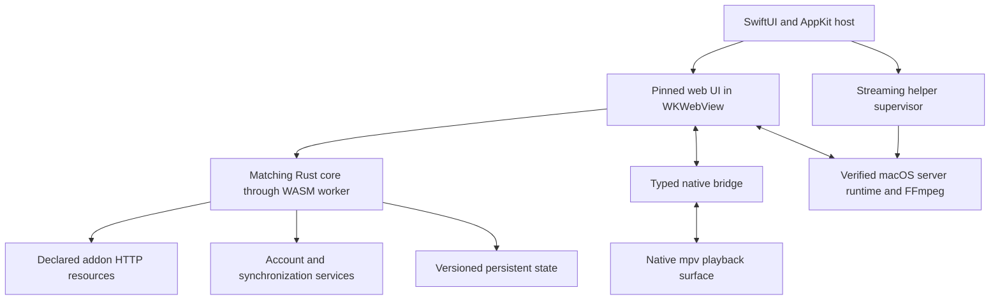

# Proposed implementation architecture

Status: proposal only. No application code has been written. The reference shell is Windows ARM64 5.0.27; macOS is the working target assumption because the workspace is on macOS and the brief prefers Apple-native technologies when applicable. Platform choice has not been explicitly confirmed.

The executable evidence points to three distinct systems: a native host/player, a hosted React UI with a Rust core bridge, and a supervised local Node streaming server. A faithful application needs all three responsibilities. A SwiftUI catalog backed by a few addon requests would leave substantial playback and state behavior unimplemented.

## Recommended route

Use a Swift/SwiftUI lifecycle with AppKit integration, a locally bundled and pinned Stremio web UI in WKWebView, its matching Rust/WASM core, and a native mpv-backed playback surface. Add a supervised macOS streaming helper with a verified build of the necessary server/FFmpeg components. This preserves the existing UI and application logic while replacing Windows-specific host integration.

This recommendation prioritizes the requested visual and functional fidelity. A fully SwiftUI-rendered interface is an alternative if native UI is the stronger requirement, but it requires recreating every layout, interaction, and navigation state. Both routes should reuse the MIT Rust core where feasible. The Windows Rust shell should serve as an interface reference while its reuse grant remains unresolved.

| Area | Fidelity-first route | Fully native UI route |
|---|---|---|
| Host | SwiftUI lifecycle + AppKit window integration | Same |
| UI | Pinned GPL web UI in WKWebView | SwiftUI screens using measured reference styles |
| Shared state | Matching Rust/WASM core and worker bridge | Rust core through a small explicit C ABI/Swift bridge |
| Playback | Native mpv surface and bridge adapter | mpv surface with SwiftUI controls matching the reference |
| Main uncertainty | WebKit/Chromium rendering, worker/WASM loading, transparent video composition, GPL distribution plan | Larger behavior/layout reconstruction, native Rust bridge effort, asset rights |

WKWebView is a proposed macOS substitution, not an observed component of the Windows artifact. A small integration prototype must prove local asset loading, worker/WASM startup, video compositing, fullscreen, keyboard focus, and subtitle overlays before committing to this route. AVFoundation can be evaluated as an alternative backend for supported formats, but it should not silently reduce the reference format/subtitle/protocol coverage. No runtime switching policy should be promised until measured.

## Module boundaries

1. **Application host.** Own window lifecycle, URL/file opening, menu commands, fullscreen, media keys, interface scaling, and shutdown. Preserve reference navigation/back behavior in the UI rather than maintaining an independent competing navigation stack.
2. **Native bridge.** Implement explicit request/response DTOs and the observed handshake/player event contract. Advertise only capabilities implemented on macOS. Validate message source/origin and supported operations; a generic arbitrary native-command bridge is unnecessary.
3. **Core adapter.** Keep the chosen core revision's action/state/effect model authoritative for catalog, metadata, addon installation, library, watched state, and profile synchronization. For the native UI alternative, expose a small versioned ABI for actions and state snapshots, rather than duplicating business logic in Swift view models.
4. **Streaming supervisor.** Package verified macOS binaries, establish readiness, discover the actual assigned port, retain bounded diagnostics, restart only under defined conditions, and terminate owned children. Follow the original's port fallback behavior where needed; do not hard-code successful startup at 11470. The extracted Windows runtime cannot run natively on macOS.
5. **Playback adapter.** Cover load/stop, seeking, resume, pause, volume/mute, speed, audio/subtitle tracks, native ASS rendering, video-ready, end reasons, and errors. Drive controls from actual player properties. Test hardware decoding, output color handling, HDR, and seeking against authorized media fixtures.
6. **Persistence and account integration.** Keep core schema migrations and guest/account behavior consistent. Use Keychain for native secrets where applicable and a versioned store for host preferences. Avoid separate competing progress records. Real account synchronization requires verified service compatibility and explicit functional tests.

Use Swift concurrency for host/service operations and clear actor ownership for UI state and player callbacks. Exact minimum macOS version, Xcode version, packaging, sandbox entitlements, signing, and distribution channel remain implementation decisions after the media and licensing gates.

## Feature and validation plan

| Capability | Existing foundation | Required acceptance evidence |
|---|---|---|
| Board/Discover/Search | Web routes, Rust catalog/filter models, addon manifests | Correct catalogs, extras encoding, paging, empty/error/loading states |
| Details/seasons/episodes | Core metadata/video IDs and UI details routes | Correct selected episode, season switching, stream lookup and back navigation |
| Library/Continue Watching/history | Core library/profile/player state | Guest persistence, resume updates, watched/unwatched behavior, migrations |
| Login and cross-device sync | Core API models | Real authorized account login and round-trip sync; conflicts and offline recovery |
| Addon catalog/install/remove/configure | Official descriptors, manifest/transport types | Real supported manifests, scoped resources, configuration URLs, failures and removal |
| HTTP/HLS playback | Native player + streaming helper | Start, pause, seek, resume, buffering/error recovery and fullscreen |
| Subtitles/audio | mpv and addon/core responses | Track switching, external/embedded subtitles, timing, ASS styling, next-media transitions |
| Quality selection | Stream list/HLS/server capabilities | Only options actually available for that source; no fabricated quality menu |
| 4K/HDR/additional protocols | Player, service, hardware/display | Per-format/device tests; explicit unsupported cases |
| Calendar, casting, local files and archives | Visible routes and shipped service code | Scope against the pinned reference, then test supported paths independently |

Tests should exercise behavior: manifest variants and malformed responses; percent encoding and nested addon URLs; metadata/video identity; storage migration and synchronization conflicts; service startup/port fallback/cleanup; player events, end reasons, and track changes. Use isolated fixtures for deterministic tests and explicitly labeled live integration checks. Use public-domain or user-authorized media.

For visual validation, first capture Windows shell 5.0.27 together with its actual UI version, OS scaling, window/client dimensions, font state, account/guest state, and catalog fixtures. Compare matching macOS client-area captures separately from platform window decorations. Freeze dynamic content, record loading/error states, and compare typography, cards, spacing, menus, and player overlays. The current Board capture is a preliminary web reference; it cannot substitute for the full Windows comparison matrix.

Before implementation, resolve the pinned UI/core version and reuse notices, and prove the macOS worker/player/helper integration. Then implement in vertical slices: guest launch and catalogs; details and addon operations; real playback and persistence; account sync; remaining reference features; matched screenshot and performance checks. Do not label a slice complete while required behavior is stubbed.

See [PHASE-1.md](PHASE-1.md) for measured artifact facts, source revisions, evidence IDs, and unresolved research questions.
