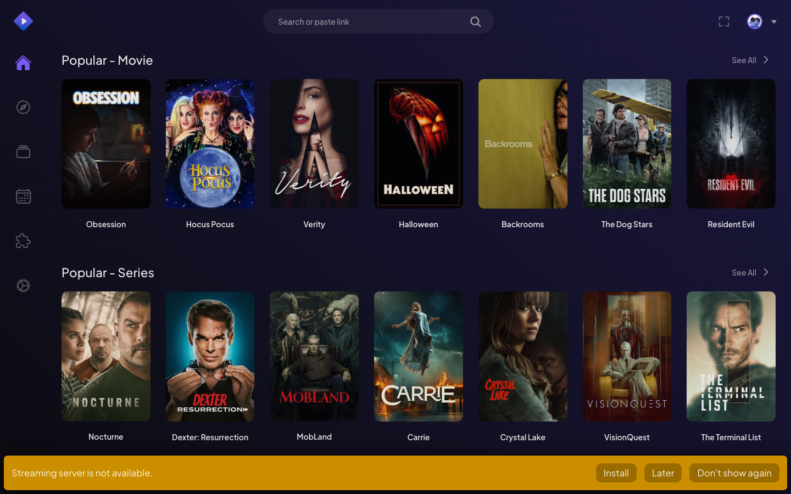

# Stremio 5.0.27: artifact-led technical analysis

Research date: 8 November 2026. Application implementation has not started. This report separates observations from the supplied installer, observations from a live web session, official source facts, and proposed design decisions.

## Result and scope

The supplied file is an Inno Setup installer for Stremio 5.0.27. Its bootstrap is x86; **every extracted native application component is ARM64**. The relevant desktop repository is `Stremio/stremio-shell-ng`, whose `v5.0.27` tag resolves to `c13b1ba07e29f42ee4850cc9e50ca1e6e89d6d41`.

This association is supported by more than names: four extracted files match the tag's Git blob identities, and the extracted mpv DLL matches the tag's archived DLL after normalizing its Authenticode signing fields. The compiled shell's version resource also reports 5.0.27. A reproducible build of the shell itself has not been performed, so its exact source commit is strongly corroborated rather than proven by a binary rebuild.

The Windows shell hosts a separately deployed web interface. Consequently, **5.0.27 identifies the shell, not an immutable complete UI/core/server release**. The installer supplies the server and player but no application HTML/CSS/React bundle. A precise reconstruction needs a separately pinned web UI revision and a Windows reference capture.

The proposed implementation is in [ARCHITECTURE.md](ARCHITECTURE.md). Outstanding research and validation are recorded below; this is not a claim that the requested complete application has been built or that every Phase 1 question is closed.

## 1. Supplied executable: direct evidence

| Property | Measured value |
|---|---|
| Input | `/Users/a.tsoulfas/Desktop/StremioSetup-v5.0.27_arm64.exe` |
| Length | 77,417,072 bytes |
| SHA-256 | `4efa0bacd5b658be998868db10907ba155beb1c9cdc352eb9d6fd875c6affe23` |
| Bootstrap format | PE32, machine `0x014c`, x86 |
| Product version | `5.0.27` |
| Product/publisher metadata | Stremio / Smart Code OOD |
| Installer format marker | Inno Setup 6.4.3 |
| Certificate table | File offset 77,405,832; length 11,240 |

REA's complete resource inventory found 24 payload resources, including six icon images, an icon group, version information, and an application manifest. The bootstrap normally imports `kernel32.dll`, `comctl32.dll`, `user32.dll`, `oleaut32.dll`, and `advapi32.dll`. Those imports describe the installer, not Stremio's playback implementation.

The embedded certificate collection includes Smart Code OOD, a Sectigo code-signing chain, and DigiCert timestamp certificates. The embedded timestamp attributes include `261020141123Z`. The SHA-256 Authenticode image digest recomputed from the PE equals the embedded digest, `0a04ebb1d29c651f3d34e631aa5eb8d04496e26d41ec5c3ae76cacf4e9f73f87`. This is an integrity comparison; RSA signature validity, certificate trust, revocation, and timestamp trust were not validated.

Sources: [installer summary](evidence/installer-summary.json), [REA resources](evidence/installer-pe-resources.json), [PE imports](evidence/installer-pe-imports.json), [image digest](evidence/installer-image-digest.json), [certificate subjects](evidence/installer-certificate-subjects.txt). REA resource Evidence: `ev_c0a649f21463953c518db95cb56f20b0f95816138dedf922ae437b52d0feb8ad`.

### Extraction and actual payload

Installed `innoextract 1.9` failed on the 6.4.3 headers. A first compatibility patch also failed. Building the more complete [upstream parser proposal #210](https://github.com/dscharrer/innoextract/pull/210), commit `376a13e7c41cc5528b6088d0dd16ec1b323a8d37`, succeeded. The only local build adaptation removed the obsolete Boost.System library component from CMake; parser code was unchanged. No Windows executable was run.

Extraction completed successfully into `/tmp/stremio-extracted-v5.0.27-arm64/app`:

| Extracted file | Bytes | Identity established from the file |
|---|---:|---|
| `stremio-shell-ng.exe` | 4,214,760 | ARM64 GUI PE32+; FileVersion/ProductVersion 5.0.27 |
| `libmpv-2.dll` | 79,099,368 | ARM64 DLL; version `v0.41.0-524-g5921fe50b` |
| `ffmpeg.exe` | 47,626,216 | ARM64 console PE32+; `7.1.3-Jellyfin` |
| `ffprobe.exe` | 47,515,112 | ARM64 console PE32+; exact tag blob match |
| `stremio-runtime.exe` | 64,472,040 | ARM64 console PE32+; Node.js engine 20.19.6 |
| `server.js` | 6,783,122 | Webpack JavaScript bundle; embedded package `stremio-server` 4.22.3 |

All file SHA-256 values are retained in [extracted-file-digests.json](evidence/extracted-file-digests.json). Extraction logs and tool provenance are in [installer-extraction-log.txt](evidence/installer-extraction-log.txt) and [extractor-provenance.json](evidence/extractor-provenance.json). The `/tmp` payload is a working artifact and may be removed by the OS; the original installer and the extraction command permit regeneration.

The compiled shell directly imports `libmpv-2.dll`, D3D11/DWM, Win32 GUI, networking, cryptography, and Visual C++ runtime APIs. No Qt or Electron runtime appears among the six payload files. This bounded payload inventory does not rule out optional system or dynamically acquired components. The Windows manifest explicitly declares per-monitor DPI awareness, including `PerMonitorV2`.

REA found ten shell resources: a PNG splash image, six icon images, an icon group, version information, and a manifest. [The extracted splash](evidence/shell-splash.png) is a real binary resource; the catalog UI is not embedded there. REA also found a `/rustc/8bab26f4f68e0e26f0bb7960be334d5b520ea452/` path and no cargo-auditable `.dep-v0` section. The compiler path supports Rust provenance but does not independently establish a compiler release or a complete dependency inventory.

REA Evidence: shell resources `ev_db3042fe38783757c60ceaecf6cb70a05b67b7c16796462ebdb1ca6abf46e3f1`; Rust inspection `ev_a7afeb432b386075c4d94f12e0755f8ab66898c21fbb273445437bee35258596`; runtime resources `ev_b703e377574089f8b07c249ee9f2285e5d0d3ebe241e21692b27e14436b98c66`; FFmpeg resources `ev_1851023a0b7b486af06761de2a9b67016276bd40f8162a596ed5b8a9b04ac291`; mpv resources `ev_b749adc237efd0c5898800f12c78ea5c73951700ad5e58592479f6c1e30ac906`.

### Comparison with the exact source tag

For each extracted file, the Git blob identity was computed over `blob <byte-length>\0<file-bytes>` and compared with the official tag's tree:

| Payload | Tag comparison |
|---|---|
| `server.js` | Exact Git blob match: `64006fdef92b5866907f2509a0e0c346b5cb832d` |
| `stremio-runtime.exe` | Exact match to `bin-arm64/stremio-runtime.exe` |
| `ffmpeg.exe` | Exact match to `bin-arm64/ffmpeg.exe` |
| `ffprobe.exe` | Exact match to `bin-arm64/ffprobe.exe` |
| `libmpv-2.dll` | Loose `mpv-arm64` DLL differs; the build's `libmpv-2_arm64.zip` is the relevant input |

The archived mpv DLL is unsigned and 79,088,128 bytes. Removing the extracted DLL's trailing certificate table and zeroing both files' PE checksum and Security Directory fields makes **all remaining bytes equal**. Both normalized SHA-256 values are `cc223b1035e37d3ca897fb859b32ccb6ba0013dece7091a3f5cc7dd2bc882b32`. This explains the apparent mismatch without treating differently signed files as byte-identical.

Sources: [tag tree](sources/shell-ng-v5.0.27-tree.json), [file comparison](evidence/payload-tag-comparison.json), [mpv normalized comparison](evidence/mpv-signature-normalized-comparison.json), [official release](https://github.com/Stremio/stremio-shell-ng/releases/tag/v5.0.27), and [tag build script](https://github.com/Stremio/stremio-shell-ng/blob/c13b1ba07e29f42ee4850cc9e50ca1e6e89d6d41/build.rs).

### What the bundled server establishes

`server.js` is shipped JavaScript, not recovered original project source. It contains 1,325 Webpack factory slots. The bootstrap selects factory 576; factory 420 contains the embedded package metadata. Their exact source ranges, hashes, and the inert AST extraction procedure are retained in [derived-module-provenance.json](evidence/derived-module-provenance.json) and [derived-server](evidence/derived-server).

Static inspection of factory 576 establishes registration code for:

- HTTP listening initially on port 11470, with retries through 11474 and then an OS-selected port; optional HTTPS on 12470.
- `/settings` GET/POST, `/heartbeat`, `/network-info`, `/device-info`, `/probe`, and `/tracks/:url`.
- HLS playlist and segment routes, `/hlsv2`, `/embedded-ass`, `/subtitles.:ext`, `/subtitlesTracks`, and `/opensubHash`.
- A local addon, proxy, optional casting middleware, and RAR/ZIP/7zip/TAR/TGZ/FTP/NZB middleware mounts.

These are registrations visible in shipped code, not proof that each feature works for every stream. Notably, the HTTP `listen(port)` call has no explicit loopback bind address, and the code constructs both local and LAN URLs. A replacement should not assume that the original service only binds to loopback.

The embedded package metadata lists pinned Git references for enginefs, torrent-stream, local addon, HLS middleware, and several archive transports. These declarations help trace provenance but are not a verified lockfile for every bundled dependency. It also retains a legacy `app.strem.io/shell-v4.4/` server fallback; that string does not make this installer Stremio 4. The native shell's own default is `web.stremio.com`.

REA parsed the full bundle but exhausted its 2 GiB semantic-analysis heap. That result is explicitly partial. The two focused factories were then analyzed independently with byte-range provenance; dynamic Webpack imports and unresolved data flows remain unknown. No server bootstrap or factory was executed. Full-bundle Evidence: `ev_c6ce3e8a4940f00d76bb80b58a91916678a0e645069c93aa33dd17495908e3f4`. Focused Evidence: `ev_3e889536fa39d7ed7107a0494f6a6c6d31b4fff3240be6c7e8215a3c2c12624d`.

## 2. Official website and repository architecture

The [home page](https://www.stremio.com/) and [Features](https://www.stremio.com/features) describe discovery, device synchronization, remote addons, and high-definition playback. They provide product scope, not an exact component manifest for this installer. References to commercial services do not establish that their subscription/DRM playback is available inside a reconstructed player.

The [Downloads page](https://www.stremio.com/downloads) distinguishes Windows Stremio 5 x64, an ARM beta, macOS Stremio 5 variants, a native macOS variant, and older desktop releases. Platform/version labels must therefore be kept separate. The [Technology page](https://www.stremio.com/technology) lists technologies across products and generations, including Qt, mpv, libVLC, Node.js, Rust, Kotlin, Swift, and React; the supplied payload and matching source identify which apply here.

The [Addon SDK page](https://www.stremio.com/addon-sdk) links official protocol documentation and describes addons supplying catalogs, search, metadata, streams, and subtitles. Those documents and the actual core transport take precedence over examples or invented endpoints. The five requested primary website pages were examined; the entire support center, historical blog, every language variant, and all linked third-party sites were not exhaustively crawled.

| Official repository | Role and inspected revision | Reuse finding |
|---|---|---|
| [stremio-shell-ng](https://github.com/Stremio/stremio-shell-ng) | Windows native host, WebView2, mpv, server supervision; tag `c13b1ba…` | Exact generation match. No root license file found at the tag; do not assume a reuse grant from public visibility. |
| [stremio-web](https://github.com/Stremio/stremio-web) | React UI; development `f70766cf76dc993689d8dac2f5598d1d24a80dc6` | GPL-2.0 license file; source is a UI reference, not a proven match to the deployed capture. |
| [stremio-core](https://github.com/Stremio/stremio-core) | Rust types, addon transport, library/profile/player models and runtime; `a8c229589ca1e84e5c6c52f2dee11c31d7c5abe2` | MIT; preserve notices. |
| [stremio-addon-sdk](https://github.com/Stremio/stremio-addon-sdk) | Addon authoring SDK and protocol; `796ca01c87496df18315e73aab30fa7d87227296` | MIT; an addon server SDK, not the client UI/runtime. |
| [stremio-video](https://github.com/Stremio/stremio-video) | Player abstraction; `7a7462bedfa51dc8303fbc4f59f16e03d0badb85` | Package declares MIT; dependency notices still need inventory. |
| [stremio-shell](https://github.com/Stremio/stremio-shell) | Older Qt host; `c3a8bcbf857d5569b6ae7444ead0dc0a0814888b` | GPL-3.0 metadata/license; not the supplied Windows shell. |
| [stremio-service](https://github.com/Stremio/stremio-service) | Separate service distribution candidate; `1891799734acba88904f9f62cb8ca491873b36fb` | GPL-2.0 metadata; macOS helper/build integration requires further review. |
| [stremio-official-addons](https://github.com/Stremio/stremio-official-addons) | Official descriptor list; `272e36095d6ece7aea97f094a02a4fb0a94def59` | MIT. Pin the list version used by the chosen core. |
| [stremio-brand](https://github.com/Stremio/stremio-brand), [stremio-icons](https://github.com/Stremio/stremio-icons), [stremio-colors](https://github.com/Stremio/stremio-colors) | Branding, icon set, palette | Icons package declares MIT; brand/font/asset rights require file-specific review. |

Repository trees and selected source files are retained under `sources/`; this is a research snapshot, not a set of complete buildable clones. Source-file digests are recorded separately. Initial top-level README/package files were fetched by default branch; deeper files were fetched using the recorded tree commit. Do not treat all development snapshots as one release lockfile.

### Source-supported component boundaries

The matching shell source uses Win32/native-windows-gui and WebView2 for the window/UI surface. It launches `stremio-runtime.exe server.js`, supervises child processes, and exchanges messages with the web UI. The extracted shell contains corroborating strings for those filenames, the hosted endpoint, updater URLs, and native player capabilities.

The handshake advertises shell version, GPU video processing, cache-directory selection, streaming-server URL, native interface scaling, and native ASS subtitles. Player messages include `mpv-command`, `mpv-observe-prop`, `mpv-set-prop`, property changes, video-ready, and ended events. This bridge is a concrete interface to reproduce, with platform-specific capabilities advertised truthfully.

The current web source uses React 18.3.1, Webpack, TypeScript/JavaScript, LESS, hash-based routing, and a worker bridge to `@stremio/stremio-core-web`. Its package version is `5.0.0-beta.43`; that is independent of native shell 5.0.27. The inspected Rust core uses an Elm-style action/model/effect runtime, abstracting fetch/storage/time/execution through `Env`. Reusing it avoids independently recreating library, watched-state, addon, and synchronization semantics.

Sources: [tag constants](https://github.com/Stremio/stremio-shell-ng/blob/c13b1ba07e29f42ee4850cc9e50ca1e6e89d6d41/src/stremio_app/constants.rs), [tag IPC](https://github.com/Stremio/stremio-shell-ng/blob/c13b1ba07e29f42ee4850cc9e50ca1e6e89d6d41/src/stremio_app/ipc.rs), [web package](https://github.com/Stremio/stremio-web/blob/f70766cf76dc993689d8dac2f5598d1d24a80dc6/package.json), and [core architecture](https://github.com/Stremio/stremio-core/blob/a8c229589ca1e84e5c6c52f2dee11c31d7c5abe2/README.md).

## 3. UI evidence and version limits

REA launched a temporary Chrome profile, navigated to `https://web.stremio.com/`, waited eight seconds, and captured a 1440×900 Board screenshot, DOM, and accessibility tree. It terminated its owned process. This observed the live web app, not the Windows executable.

The capture shows Board, Discover, Library, Calendar, Addons, and Settings navigation, a search field, populated catalog rows, and a missing-streaming-server warning. Catalog availability was observed; playback was not. No account credentials or personal browser profile were used.

The DOM references scripts under `f0222603bb8119d8a63958ad8acfd025de973f2e/`. That is an observed deployment identifier, **not a verified Git commit**: GitHub's tree lookup returned HTTP 422. The development snapshot therefore remains a separately labeled implementation reference.

REA Evidence: `ev_6c956429f6a644779270437deea6395de029e9f068cae145503a862d34338053`, retained in [web-board-rea-record.json](evidence/web-board-rea-record.json).

### Preliminary UI inventory from the inspected source

Routes cover Board, Intro/login, Discover, Library, Calendar, Continue Watching, Search, metadata details, Addons, Settings, Player, and Not Found. Details include episode/season selection and stream lists. Player source includes seeking, volume, audio/subtitle menus, speed, statistics, casting, episode navigation, buffering, and errors. Settings groups include General, Interface, Player, Streaming, and Shortcuts.

The source's typography is Plus Jakarta Sans, with Twemoji flag fallback. Its base colors include background `#0C0B11`, secondary background `#1A173E`, primary accent `#7B5BF5`, green `#22B365`, and modal background `#0F0D20`. Default navigation dimensions are 5.5rem horizontal and 6rem vertical; corner radius is 0.75rem. These are source values, not universal fixed pixel measurements: root font size, interface scale, viewport, and platform affect rendered dimensions.

Source breakpoints run from 640px through 3800px. At a 1440px viewport the inspected development CSS selects a 14px root font size at default interface scale. Fade-in animation is 350ms with a small vertical translation; route slides use 300ms transitions and reduced-motion handling exists. The native shell source sets a minimum window size of 1000×600. These source values still require Windows screenshot confirmation against the chosen UI revision.

Sources: [routes](https://github.com/Stremio/stremio-web/blob/f70766cf76dc993689d8dac2f5598d1d24a80dc6/src/router/routerPaths.tsx), [application styles](https://github.com/Stremio/stremio-web/blob/f70766cf76dc993689d8dac2f5598d1d24a80dc6/src/App/styles.less), [breakpoints](https://github.com/Stremio/stremio-web/blob/f70766cf76dc993689d8dac2f5598d1d24a80dc6/src/common/screen-sizes.less), and [animations](https://github.com/Stremio/stremio-web/blob/f70766cf76dc993689d8dac2f5598d1d24a80dc6/src/common/animations.less).

## 4. Protocol and feature implications

The official client transport builds resource URLs from an addon manifest URL. Supported resources, types, ID prefixes, required extras, and catalog options must drive requests. Modern HTTP paths use `/manifest.json` and `/{resource}/{type}/{id}[/{encodedExtras}].json`; extras are encoded in a path segment, not automatically appended as a normal URL query. Series metadata IDs and episode video IDs must remain distinct. The inspected core also retains a legacy transport adapter.

Streams can be direct URLs, torrent descriptors, YouTube IDs, external links, and other declared forms. The full experience therefore requires the streaming service and player adapter in addition to a catalog browser. Quality selection can mean choosing separate stream entries, selecting HLS variants, or changing a server profile; it is not guaranteed for every URL. Audio/subtitle options depend on actual media tracks and addon results. HDR and 4K claims require tests on the target display and decode/output path.

The inspected SDK protocol includes optional player/library event resources and newer EPG conventions. They must not automatically be attributed to every UI or core paired with shell 5.0.27. The documentation also contains stale illustrative inconsistencies, such as a singular subtitle example path; use the actual transport and typed responses to resolve them.

Account synchronization is implemented through the core/API model layer. The public addon protocol does not itself grant access to Stremio accounts, service credentials, or DRM providers. Real guest persistence, account login, library merging, progress sync, and conflict handling need separate verification. Favorites should be mapped to the original's actual library/like semantics rather than introduced as an unrelated feature.

Sources: [protocol](https://github.com/Stremio/stremio-addon-sdk/blob/796ca01c87496df18315e73aab30fa7d87227296/docs/protocol.md), [stream response](https://github.com/Stremio/stremio-addon-sdk/blob/796ca01c87496df18315e73aab30fa7d87227296/docs/api/responses/stream.md), [subtitle response](https://github.com/Stremio/stremio-addon-sdk/blob/796ca01c87496df18315e73aab30fa7d87227296/docs/api/responses/subtitles.md), and [actual HTTP transport](https://github.com/Stremio/stremio-core/blob/a8c229589ca1e84e5c6c52f2dee11c31d7c5abe2/src/addon_transport/http_transport/http_transport.rs).

## 5. Reuse and licensing findings

The core and addon SDK carry MIT license files; reuse requires preserving their notices. The web UI carries GPLv2 text; distributing a modified/derived UI requires planning for the applicable GPL source and notice obligations. Package metadata alone is weaker evidence than a complete license/notice inventory, and the license of a Rust wrapper does not determine the license of its linked media library.

The **actual extracted mpv resource explicitly declares GPL version 2 or later**. The FFmpeg executable includes `--enable-gpl`, `--enable-version3`, and additional codec build strings. These shipped Windows binaries should not be assumed to be generic LGPL-only media components or repackaged as macOS dependencies. Select macOS builds with known source, configuration, and notices.

The extracted server starts with a reference to `server.js.LICENSE.txt`, but that sidecar is absent from the six extracted files. This is a bounded observation about the installer payload, not a conclusion about the publisher's overall compliance. Recover its dependency notices before redistributing the bundle. Likewise, the shell-ng tag contains no identified root license file. A public GitHub repository, a marketing statement about open source, or branding assets' availability is insufficient to assign a license not present in the reviewed materials.

Before distribution, complete a bill of materials for the selected UI, fonts, icons, Rust crates, server dependencies, mpv, FFmpeg, and any codec libraries. Preserve notices and changed-file markings where required, and review the actual combined distribution. Branding/trademark and remote poster-art permissions are separate from software licenses.

Primary license texts: [core MIT](https://github.com/Stremio/stremio-core/blob/a8c229589ca1e84e5c6c52f2dee11c31d7c5abe2/LICENSE.md), [SDK MIT](https://github.com/Stremio/stremio-addon-sdk/blob/796ca01c87496df18315e73aab30fa7d87227296/LICENSE.md), [web GPLv2](https://github.com/Stremio/stremio-web/blob/f70766cf76dc993689d8dac2f5598d1d24a80dc6/LICENSE.md). Binary license facts are retained in the resource and string-anchor evidence files.

## 6. Research status and next gates

| Research question | Status |
|---|---|
| Supplied file identity, installer version, payload list and architecture | Answered by static inspection and successful extraction |
| Correct Windows shell repository and release | Strongly corroborated by shell resources, exact ancillary file matches, and normalized mpv match |
| Exact compiled shell/source equivalence | Unresolved without a reproducible build or stronger build provenance |
| Actual server/runtime/player component versions | Answered to embedded metadata/static evidence limits |
| Architecture and addon request construction | Answered from corresponding shell source, shipped bundle, and explicit current-source snapshots |
| Complete native decompilation | Unavailable: Ghidra, Hopper, and IDA are not configured; no installation was performed |
| Exact hosted UI/core revision used by the Windows app | Unresolved; shell default is remote and the captured deployment ID did not resolve as a public Git tree |
| UI hierarchy/styles | Preliminary source inventory plus one live web Board capture; exhaustive screen measurements remain |
| Windows runtime behavior and pixel comparisons | Unresolved: Windows ARM64 application not launched on this macOS host |
| Complete reuse clearance | Partial: core/SDK/web licenses identified; shell grant and complete binary/font/asset/dependency notices remain |
| Functional recreation, playback, synchronization, performance | Not implemented or validated in this phase |

The next research work is to pin the UI paired with the reference run, obtain Windows ARM64 screenshots/behavior at agreed viewport and DPI settings, resolve distribution rights/notices, and validate a macOS media/service integration. Those gates remain visible rather than being replaced by placeholder features.

The retained evidence has static coverage limits even where a resource inventory is complete. The REA bundle's top-level unknown ledger count must not be read as zero unresolved research questions; the partial JavaScript records and this table contain additional limits.
